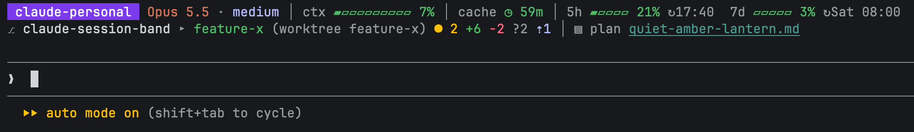

# session-band

A Claude Code mod that keeps a two-line status band directly above the prompt, so every
terminal session tells you at a glance where it is and what it is spending:



```
 claude-personal  Opus 5.5 · medium │ ctx ▰▰▱▱▱▱▱▱▱▱ 20% │ cache ◷ 52m │ 5h ▱▱▱▱▱ 3% ↻22:00  7d ▰▱▱▱▱ 29% ↻Mon 08:00
⎇ my-project ▸ feature-x (worktree feature-x) ● 3 +120 −35 ?2 ⇡1 │ ▤ plan fluttering-spinning-acorn.md
```

In plain words: when you run several Claude Code sessions side by side (several projects,
several git worktrees, two Claude profiles), they all look the same. The band answers the
questions you would otherwise type `/status`, `/context`, `/usage` or `git status` for, and it
updates by itself.

## What each part shows

**First line: the session and its budget**

- **Profile badge**: the Claude config directory the session runs under (`CLAUDE_CONFIG_DIR`,
  default `~/.claude`), without the leading dot. A profile whose name contains `personal` is
  violet, any other amber, so two profiles never look alike.
- **Model · effort**: the model and the reasoning effort. A change with `/effort`, `/model` or
  `/config` shows at once; otherwise the effort sent with the last request, and before the first
  reply the `effortLevel` from your settings.
- **ctx**: how full the context window is, as a bar and a percentage.
- **cache**: whether the prompt cache still holds the conversation, so the next message is
  cheap and fast. `◷ 52m` while warm, with the time left (yellow when a one-hour cache has
  under five minutes left); `cold 2h idle` once it has expired. The lifetime (5 minutes or
  1 hour) is read from the last request's cache write and counts from when that request was
  sent. `–` until the session's first request.
- **5h / 7d**: the usage-limit windows your plan reports, as a bar, a percentage and the local
  time each one resets (`↻22:00` today, `↻Mon 08:00` later). They appear after the first reply.

The bars are green below 50 %, yellow below 80 % and red above.

**Second line: where the session works**

- **⎇ repo ▸ branch**: the repository (for a git worktree, the main repository's name), the
  branch, and `(worktree <name>)` when the session runs in a linked worktree.
- **Git changes**, in the usual prompt-theme style. Marks that are zero are left out:
  - `✓`: clean
  - `● 3`: three files changed, staged or unstaged
  - `+120 −35`: lines added and removed against `HEAD`
  - `?2`: untracked files
  - `✗1`: merge conflicts
  - `⇡1⇣2`: commits ahead of and behind the upstream branch
- **▤ plan**: the session's plan file, as a clickable link (OSC 8; Cmd+click or Ctrl+click in
  terminals that support it opens it in your default Markdown app). Found in this order:
  1. the plan that plan mode wrote for this session (`<config dir>/plans/<slug>.md`);
  2. otherwise the `~/.claude*/plans/<name>.md` file the conversation mentioned last, for a
     session that carries on a plan an earlier session made.

The band collapses with `ctrl+x ctrl+a` or the `[-]` at its end.

## Install

At the prompt of a terminal session:

```
/plugin install session-band --marketplace Irratzo/claude-session-band
```

From a shell:

```
claude plugin install session-band --marketplace Irratzo/claude-session-band
```

Running sessions pick it up with `/reload-plugins`; new sessions load it by themselves.
If you use several Claude profiles (several `CLAUDE_CONFIG_DIR`s), install it in each, e.g.
`CLAUDE_CONFIG_DIR=~/.claude-personal claude plugin install …`.

Switch it off with `claude plugin disable session-band`, remove it with
`claude plugin uninstall session-band`.

## Requirements and cost

- Claude Code 2.1.328 or newer (the mods API it uses). On older builds some fields stay
  empty and reset times may show in UTC.
- git 2.31 or newer.
- **No tokens.** The mod never calls the model and adds nothing to the prompt. Every figure
  comes from data Claude Code already holds, from your environment, from local `git`, or from
  the session's transcript on disk.
- A little local work: four short git commands every 30 s (run with `--no-optional-locks`, so
  they never block another process's git), and a read of at most the last 4 MiB of the session
  transcript at start and after each reply.

The band is drawn in terminal sessions (and the desktop and mobile apps). The VS Code
extension does not draw this part of the interface, so there it stays invisible.

## Limits

- The plan lookup reads only the last 4 MiB of the transcript; a plan last mentioned earlier
  than that is not found.
- When a conversation mentions several plan files, the band shows the one mentioned last.
- Git figures and the cache timer refresh every 30 s and after each reply, not continuously.
- The cache timer is an estimate from the last request, as Claude Code's own indicator is: the
  server may drop an entry earlier, and a background request (a summary, a subagent reading
  the same prompt) can renew it unseen.

## Files

- `hooks/register.tsx`: the whole mod
- `types/index.d.ts`: the shape of the state the band draws from
- `assets/demo.png`: the screenshot above
- `.claude-plugin/plugin.json`, `.claude-plugin/marketplace.json`: the manifest and the
  one-entry marketplace the install line reads

MIT licensed.
